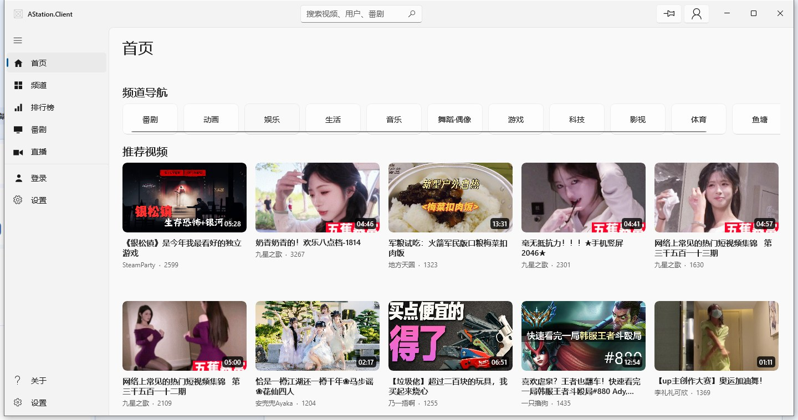
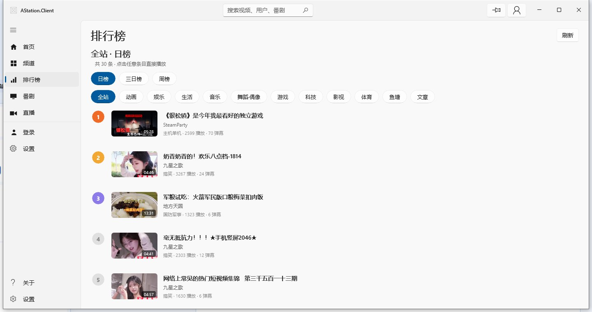
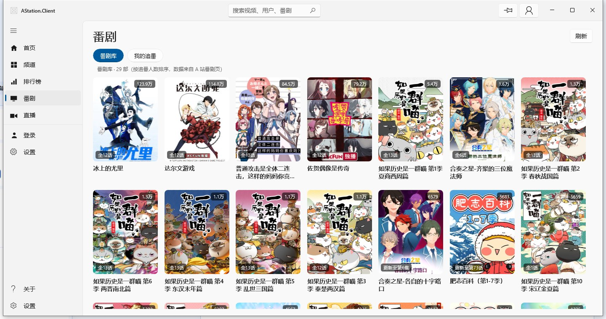
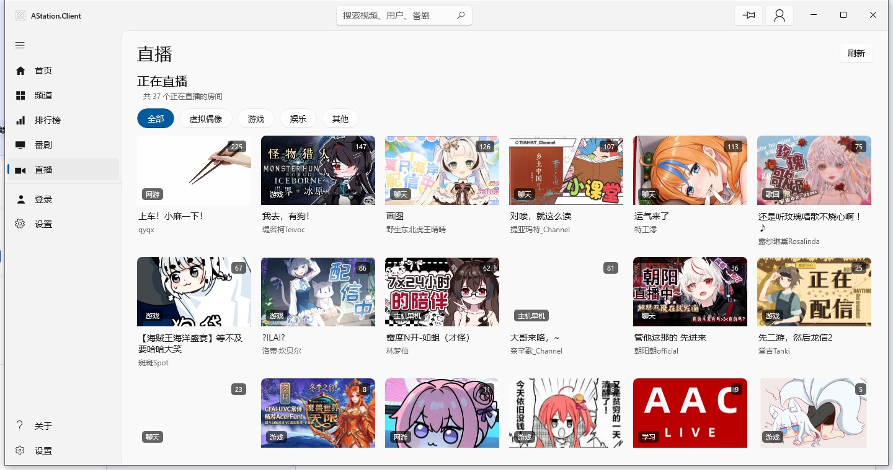
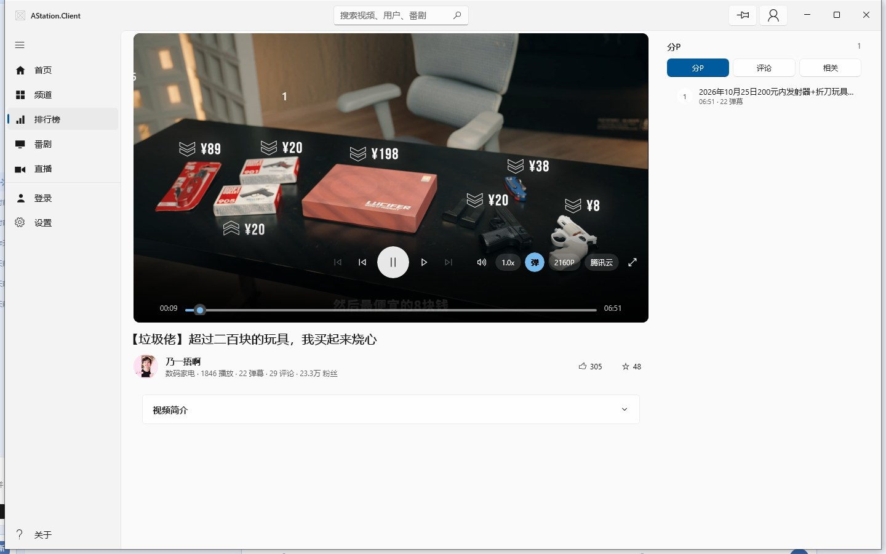
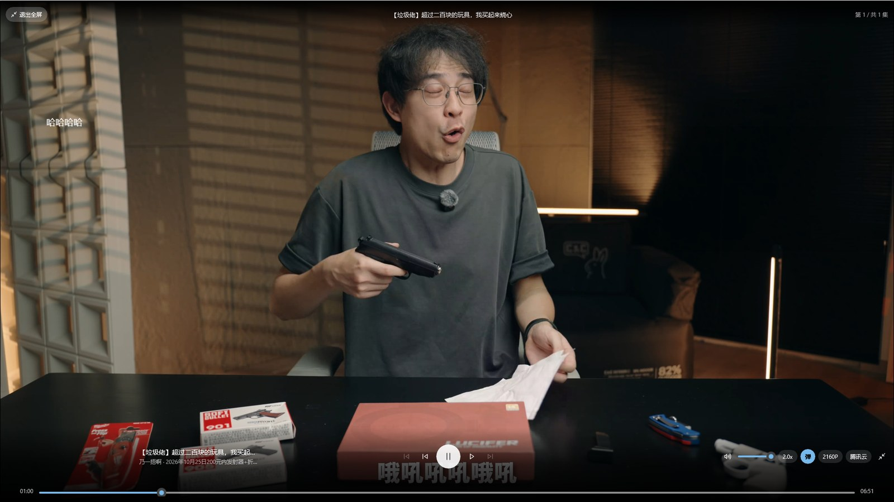
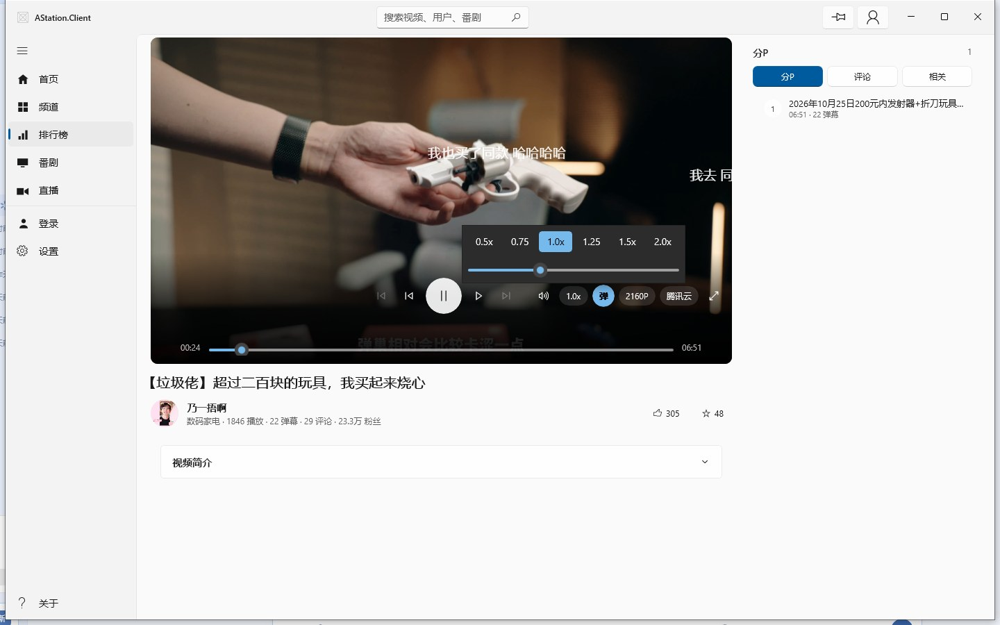
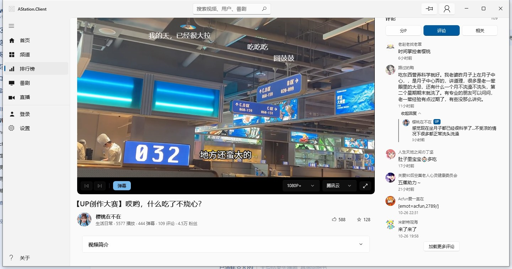

<p align="center"></p>

# AStation.Client

AcFun 第三方桌面客户端，基于 **WinUI 3 / .NET 10**，unpackaged 直跑（不需要 MSIX 安装）。

当前版本 **0.1** · Windows 10 1809 及以上 / x64

---

## 截图

<table>
  <tr>
    <td width="50%"></td>
    <td width="50%"></td>
  </tr>
  <tr>
    <td align="center"><sub>首页 · 频道导航与推荐视频</sub></td>
    <td align="center"><sub>排行榜 · 日榜 / 三日榜 / 周榜，按频道筛选</sub></td>
  </tr>
  <tr>
    <td></td>
    <td></td>
  </tr>
  <tr>
    <td align="center"><sub>番剧 · 番剧库与我的追番</sub></td>
    <td align="center"><sub>直播 · 分区筛选，点击直接进直播间</sub></td>
  </tr>
</table>

<table>
  <tr>
    <td width="50%"></td>
    <td width="50%"></td>
  </tr>
  <tr>
    <td align="center"><sub>播放页 · 控制层浮在画面底部，右侧分 P / 评论 / 相关视频</sub></td>
    <td align="center"><sub>全屏 · 无白边铺满，顶栏标题与退出按钮随控制层一起收起</sub></td>
  </tr>
  <tr>
    <td></td>
    <td></td>
  </tr>
  <tr>
    <td align="center"><sub>倍速 · 6 档快捷档位 + 0.5~2.0 无级滑杆</sub></td>
    <td align="center"><sub>评论 · 楼中楼按需展开</sub></td>
  </tr>
</table>

## 功能

**浏览**

- 首页推荐、频道导航
- 排行榜：全站 / 各频道，日榜、三日榜、周榜
- 番剧库、我的追番（需登录）、选集连播
- 直播大厅：分区筛选、进直播间看 FLV 流；直播间与点播共用同一套播放器控制层，右栏可查直播信息、码率档位与实时弹幕
- 直播弹幕：接快手 `zt.live` 的 protobuf 长连接（TCP），进房补一批最近评论，之后实时滚动
- 我的空间：账号卡 + 播放历史（含进度与观看时间），收藏夹留空态
- 账号登录（密码登录），会话持久化到本地，重启不用重登

**播放**

- 弹幕层：开关、不透明度、字号、滚动速度均可调
- 倍速 0.5x ~ 2.0x，切集后自动保持
- 清晰度、线路（主 / 备用 CDN）切换，可优先 HEVC
- 自绘进度条：拖动预览、松手跳转，弹幕同步快进
- 全屏无白边，Esc 退出；控制层 2.5 秒自动收起，底部留一条细进度

**其他**

- 评论楼中楼展开
- 分 P 与选集、相关视频；右栏分页切换带淡入上移过渡
- 设置项：主题（跟随系统 / 锁定浅色深色）、侧边栏常驻、默认清晰度、自动播放、继续上次进度、优先备用 CDN
- 窗口尺寸、位置与最大化状态退出后记住，下次启动还原（记录的位置落在屏幕外时自动居中）

## 下载

到 [Releases](https://github.com/fansa91/AStation.Client/releases) 下载对应压缩包，解压后双击 `AStation.Client.exe`：

| 包 | 说明 |
|---|---|
| `AStation.Client-<版本>-win-x64-self-contained.zip` | 内置 .NET 运行时，解压即用 |
| `AStation.Client-<版本>-win-x64-framework-dependent.zip` | 体积更小，需先装 [.NET 10 Desktop Runtime (x64)](https://dotnet.microsoft.com/download/dotnet/10.0) |

两个版本都已内置 Windows App SDK 运行时，不需要额外安装 Windows App Runtime。

## 从源码构建

需要 .NET 10 SDK，Windows 10 1809 及以上。

```bash
git clone https://github.com/fansa91/AStation.Client.git
cd AStation.Client

# 构建
dotnet build AStation.Client.csproj -c Debug
# 产物：bin/Debug/net10.0-windows10.0.26100.0/win-x64/AStation.Client.exe

# 本地打包（与 CI 产物一致）
dotnet publish AStation.Client.csproj -c Release -r win-x64 \
  --self-contained true -p:Platform=x64 -o publish
```

单元测试：

```bash
dotnet test AStation.Client.Tests/AStation.Client.Tests.csproj
```

## 命令行工具

`AStation.Client.Console` 是一个独立的命令行项目，只引用 `AStation.Client.Core`，用同一套服务层直接打接口——查接口、验数据、批量下载都不必开界面。也可以当成「Core 的 API 使用示例」来读：每个命令对应一个 Service 调用。

```bash
# 构建
dotnet build AStation.Client.Console/AStation.Client.Console.csproj -c Debug
# 产物：AStation.Client.Console/bin/Debug/net10.0/AStation.Client.Console.exe

# 搜索（sortType：1 综合 / 2 最多播放 / 5 最新发布）
AStation.Client.Console.exe search 猫 --sort 2 --limit 10

# 视频详情、评论、弹幕
AStation.Client.Console.exe video 3261720
AStation.Client.Console.exe comments 3261720 --page 1 --limit 10
AStation.Client.Console.exe danmaku 4494978 --limit 20     # 用分P 的 videoId，不是 acId

# 榜 / 番剧 / 直播
AStation.Client.Console.exe rank --channel 0 --period week
AStation.Client.Console.exe bangumi list
AStation.Client.Console.exe live play 934542 7b_30oOFkR8
AStation.Client.Console.exe livedanmaku 934542 --seconds 20   # 直播间实时弹幕（TCP 长连接）

# 取流与下载（HLS 分片会自动带上清单的签名 query）
AStation.Client.Console.exe play 3261720
AStation.Client.Console.exe download 3261720 --quality 720 -o cat.ts --mp4

# 调试用：UBB 正文解析、表情字典
AStation.Client.Console.exe ubb "好耶[emot=acfun,1738/]"
AStation.Client.Console.exe emotes --keyword 笑
```

所有命令都支持 `--json`（输出原始结构，可直接接 `jq`）。完整用法见 `AStation.Client.Console.exe help`。

常用参数可以写进配置文件，格式照 BBDown 的 `BBDown.config`：一行一个参数、值写下一行、`#` 注释。

```config
--h264
--limit
10
--quality
720
```

放在 exe 旁边或当前目录即默认生效，也可以用 `--config-file <路径>` 指定、`--no-config` 跳过；
命令行上同名参数优先。`AStation.Client.Console.exe config init` 生成模板，`config show` 看解析结果。

> 本机 .NET 不在默认路径时，运行前需要 `$env:DOTNET_ROOT='C:\dotnet'`（或把 `C:\dotnet` 加进 PATH）。

## 版本与发布

版本号由 git tag 驱动，形如 `v0.1.0`。打 tag 推送后 GitHub Actions 会自动构建并发布 Release：

```bash
git tag v0.1.0
git push origin v0.1.0
```

每次发布产出 4 个 x64 包（自包含 / 框架依赖各两份），版本号全部取自 tag：

| 包 | 内容 |
| --- | --- |
| `AStation.Client-<ver>-win-x64-self-contained.zip` | 桌面端，内置 .NET 运行时 |
| `AStation.Client-<ver>-win-x64-framework-dependent.zip` | 桌面端，需 .NET 10 Desktop Runtime |
| `AStation.Client.Console-<ver>-win-x64-self-contained.zip` | 命令行工具，内置 .NET 运行时 |
| `AStation.Client.Console-<ver>-win-x64-framework-dependent.zip` | 命令行工具，需 .NET 10 Runtime（不需 Desktop） |

桌面端两个包始终内置 Windows App SDK 运行时；`SHA256SUMS.txt` 用于校验完整性。命令行工具不依赖 WinUI，自包含包可以直接拷到任意 Windows x64 机器上跑。

## 项目结构

```
.
├── AStation.Client/          WinUI 3 界面（页面、控件、转换器）
│   ├── Styles/               设计令牌（Tokens.xaml）+ 共享控件样式（Controls.xaml）
│   ├── Controls/             MediaCard / StatePanel / PlayerOverlay / DanmakuPanel / UbbText
│   └── Pages/                主页面 + Overlay/（登录、用户空间）
├── AStation.Client.Core/     纯 .NET 服务与模型，可单测（界面与命令行共用）
├── AStation.Client.Console/  命令行工具，直接调用 Core 的接口层（见下文「命令行工具」）
├── AStation.Client.Tests/    xUnit 测试，只引用 Core
├── docs/                     布局改造方案（ui-layout-plan.md）、README 截图
├── tools/                    本地 UI 自动化验证脚本、图标生成脚本（make-icon.py）
└── .github/workflows/        Release 构建与发布
```

## 界面与布局

一套令牌 + 断点驱动的布局，视觉参照 Fluent Design（对齐 Bili.Copilot 的信息结构）。

**设计令牌**：`Styles/Tokens.xaml` 定义间距（`PagePadding` / `PagePaddingNarrow`）、圆角（卡片 8 / 按钮 4 / 胶囊 16 / 播放器 10）、字号阶梯（页面标题 28 / 区块标题 20 / 卡片标题 14 / 正文 14 / 元信息 12）与语义色；`Styles/Controls.xaml` 只放控件样式，页面里不再写裸数值。

**主窗口**：自定义标题栏 6 列（汉堡 / 品牌 / 后退 / 弹性搜索框 / 置顶·账号 / 系统按钮让位），`NavigationView` 三态随宽度切换，内容区在超宽屏限宽居中。账号、设置、关于固定放导航底部。

| 断点 | 行为 |
| --- | --- |
| ≥ 1600 / ≥ 1920 | 内容列限宽 1600 / 1920 居中 |
| ≥ 1200 | 导航展开（240），标题栏显示品牌名与搜索框 |
| ≥ 1000 | 导航紧凑（48），标题栏只留图标 |
| < 1000 | 导航收成覆盖模式，搜索框收成图标按钮 |

**播放页**：`LayoutGrid` 分「左 `*`（最小 320）/ 右 340~380」，播放器在左列第 0 行，选集/相关/评论按 340（≥1280 时 380）挂在右列并跨两行；窗口 < 1040 时右侧面板被搬移到左列下方上下堆叠，播放器按可用高度比例收窄而不是硬压黑边。评论从右侧窄栏移到播放器下方通栏，读长评论不再被 340px 挤成一列字。全屏时隐藏导航壳与右栏，只留画面 + 控制层。

**内容页**：首页 = 榜单 Hero（16:9 主图 + 右侧三条）+ 分区胶囊条 + 推荐网格（`ItemsRepeater` + `UniformGridLayout`）；番剧用 3:4 封面卡片；排行榜行高统一 76；卡片一律走 `Controls/MediaCard`（封面比例、角标、悬停只变底色和描边）。

**覆盖层**：登录 / 用户空间共用一个壳（scrim + 居中卡片，最宽 880 / 最高 760，随窗口收缩，Esc 或点遮罩关闭）。壳挂在窗口根节点而不是 `NavigationView` 内部，这样遮罩能盖住标题栏与导航，也不会因禁用导航把覆盖层自己的控件一起变灰。搜索不走覆盖层——它是 `MainFrame` 里的独立页面，进后退栈，回到搜索页保留关键词、排序与滚动位置。

**状态**：所有列表页统一用 `Controls/StatePanel`（加载 / 空 / 失败 + 重试），覆盖层形式呈现，状态切换不顶动页面布局。

## 技术要点

- **播放链路**：点播 HLS 经本地代理转发——CDN 签名挂在 m3u8 的 query 上，相对分片路径会丢签名导致 403，代理把分片重写成绝对地址并保留原 query
- **直播 FLV**：Media Foundation 不支持 FLV，用 FFmpegInteropX 解码后交给 `MediaPlayer`
- **统一播放器层**：`Controls/PlayerOverlay.xaml` 一套外壳同时服务点播与直播（视频区 / 弹幕层 / 顶栏 / 160px 控制层 / 气泡 / 迷你进度 / 全屏 / 自动隐藏），直播形态收成 96px 单行并隐藏进度与倍速；页面只负责取流与业务数据
- **弹幕**：用 16ms `DispatcherTimer` 逐帧推进，不用 Storyboard 动 `TranslateTransform`（WinUI 3 下不插值）
- **直播弹幕**：快手 `zt.live` 的二进制协议（magic `0xABCD0001` + protobuf 头 + AES-CBC 载荷）走 TCP `slink.gifshow.com:14000`，握手/注册/进房/心跳交给 `AcFunDanmu` 库，本仓库自己取令牌并准备进房参数。两处与库默认行为不同，必须覆盖：令牌要传**字符串的 UTF-8 原始字节**（库按 base64 解 → 握手被判定 `10026 token 过期`），密钥要传 `acSecurity` 的 **base64 解码结果**（库按 UTF-8 取字节 → `10012 解密失败`）。评论有两条来路：`ACTION_SIGNAL/COMMENT` 是实时流，`STATE_SIGNAL/RECENT_COMMENT` 是进房时补的历史，按「用户+时间+内容」去重
- **全屏**：Win32 `WS_POPUP` + `SetWindowPos` 铺满显示器，同时抵消 NavigationView 预留的 48px 与列间距

## 已知限制

- 扫码登录不可用（AcFun 扫码接口签了客户端指纹，`scanResult` 恒返回 `result=10 client error`），只支持账号密码登录；账号要填手机号或邮箱，验证码区分大小写
- 登录会话是 Cookie，保存在 `%LOCALAPPDATA%\AStation.Client\cookies.json`（退出登录即删除）；启动时会用 `personalInfo` 自检一次，Cookie 过期就自动退回未登录，不会再出现「标题栏显示已登录、点收藏 401」的假登录
- 楼中楼只能拿到每个主楼的前 3 条回复，官方没有「更多回复」接口
- 搜索只覆盖视频（用户 / 番剧的搜索接口返回 HTML 页，未接入），且接口只下发前 30 条
- 用户空间页已接播放历史；收藏夹没有公开接口（`/collect/list`、`/favorite/list` 等 7 个候选路径全部 404），先留空态
- 播放器暂无键盘快捷键，只有 `Esc` 退出全屏
- 直播弹幕只渲染文字：表情走富文本标记，目前按原文显示，未做图形化

## 声明

本项目为第三方非官方客户端，与 AcFun 官方无关。所有视频、弹幕、评论内容版权归原作者及平台所有，本客户端仅做展示。
