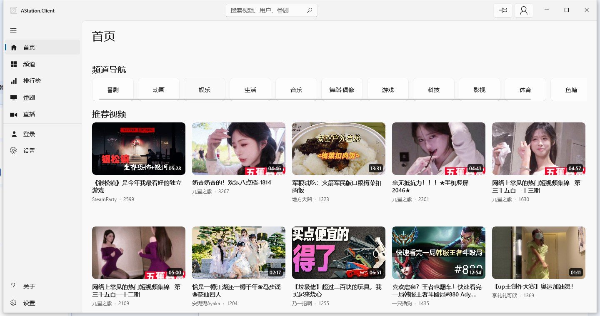
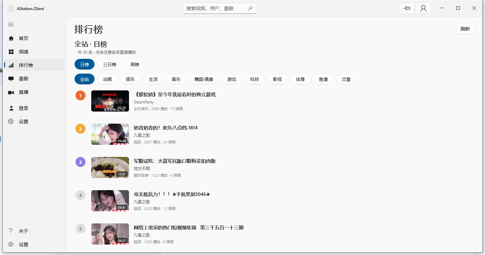
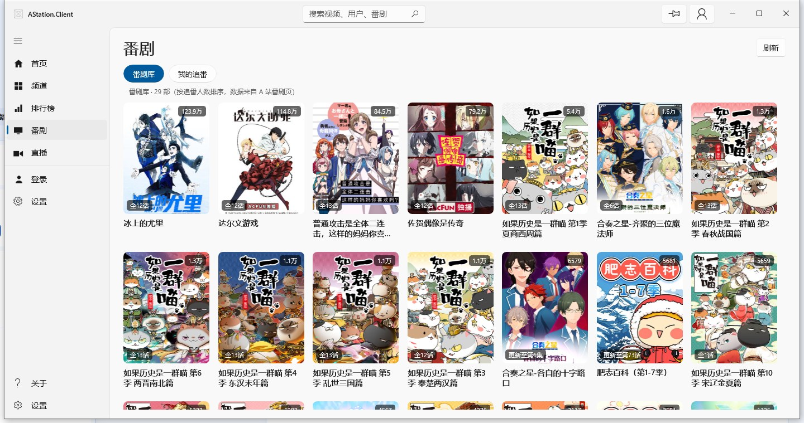
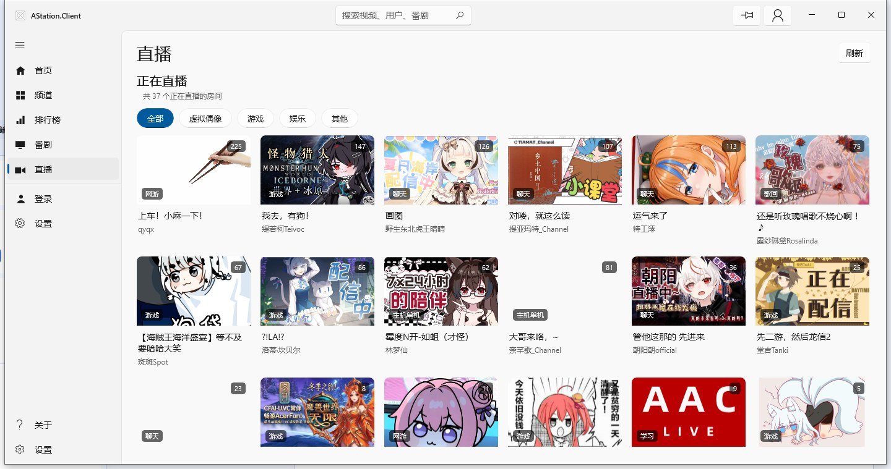
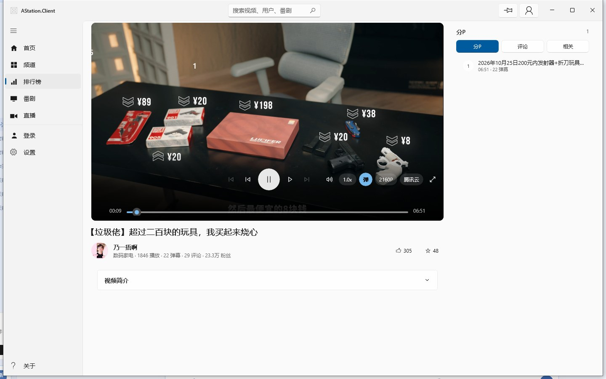
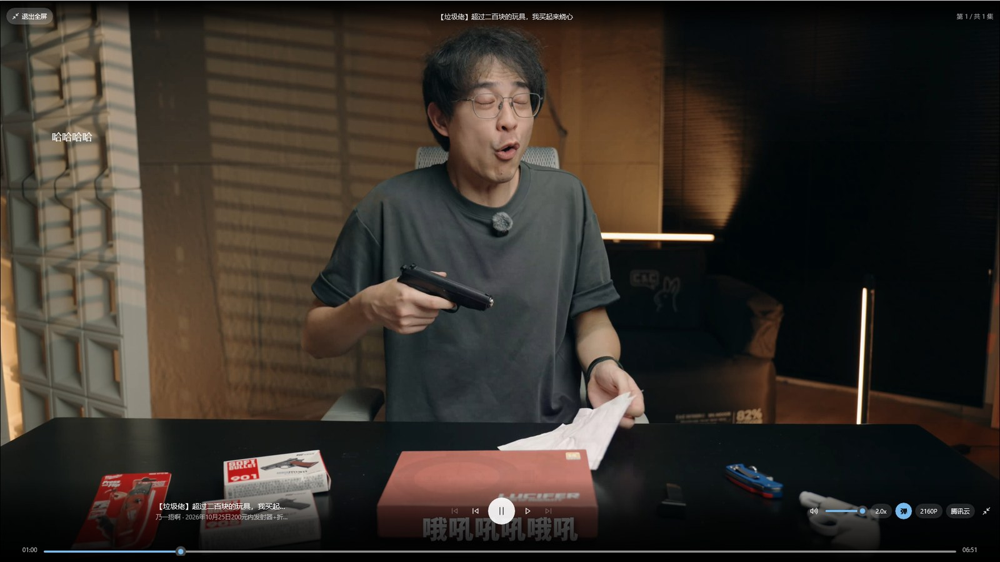
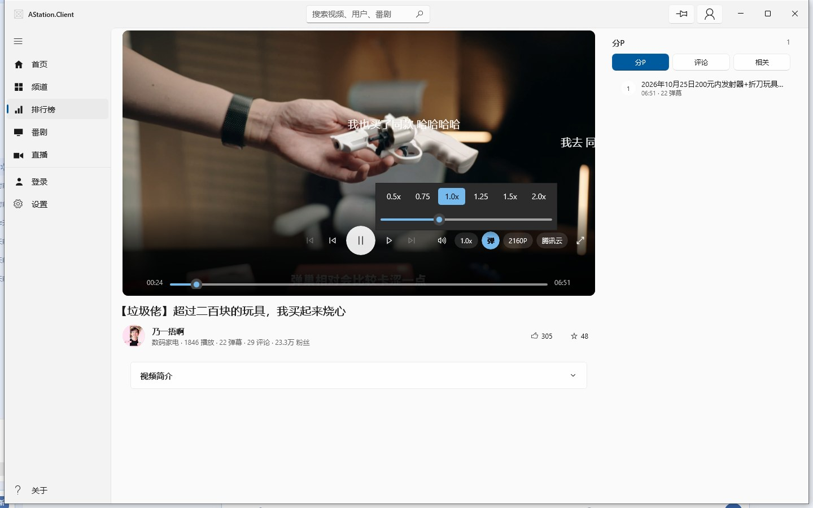
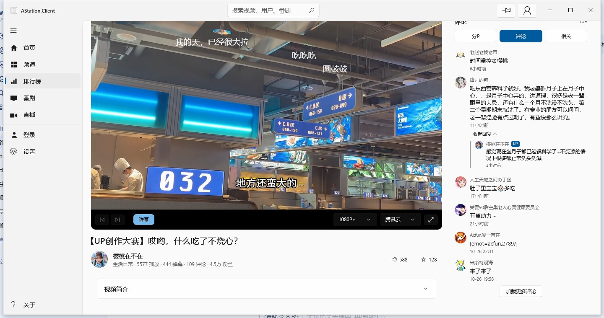

<p align="center"></p>

# AStation.Client

AcFun 第三方桌面客户端，基于 **WinUI 3 / .NET 10**，unpackaged 直跑（不需要 MSIX 安装）。

当前版本 **0.1** · Windows 10 1809 及以上 / x64

---

## 截图

<table>
  <tr>
    <td width="50%"></td>
    <td width="50%"></td>
  </tr>
  <tr>
    <td align="center"><sub>首页 · 频道导航与推荐视频</sub></td>
    <td align="center"><sub>排行榜 · 日榜 / 三日榜 / 周榜，按频道筛选</sub></td>
  </tr>
  <tr>
    <td></td>
    <td></td>
  </tr>
  <tr>
    <td align="center"><sub>番剧 · 番剧库与我的追番</sub></td>
    <td align="center"><sub>直播 · 分区筛选，点击直接进直播间</sub></td>
  </tr>
</table>

<table>
  <tr>
    <td width="50%"></td>
    <td width="50%"></td>
  </tr>
  <tr>
    <td align="center"><sub>播放页 · 控制层浮在画面底部，右侧分 P / 评论 / 相关视频</sub></td>
    <td align="center"><sub>全屏 · 无白边铺满，顶栏标题与退出按钮随控制层一起收起</sub></td>
  </tr>
  <tr>
    <td></td>
    <td></td>
  </tr>
  <tr>
    <td align="center"><sub>倍速 · 6 档快捷档位 + 0.5~2.0 无级滑杆</sub></td>
    <td align="center"><sub>评论 · 楼中楼按需展开</sub></td>
  </tr>
</table>

## 功能

**浏览**

- 首页推荐、频道导航
- 排行榜：全站 / 各频道，日榜、三日榜、周榜
- 番剧库、我的追番（需登录）、选集连播
- 直播大厅：分区筛选、进直播间看 FLV 流；直播间与点播共用同一套播放器控制层，右栏可查直播信息与码率档位
- 账号登录（密码登录）

**播放**

- 弹幕层：开关、不透明度、字号、滚动速度均可调
- 倍速 0.5x ~ 2.0x，切集后自动保持
- 清晰度、线路（主 / 备用 CDN）切换，可优先 HEVC
- 自绘进度条：拖动预览、松手跳转，弹幕同步快进
- 全屏无白边，Esc 退出；控制层 2.5 秒自动收起，底部留一条细进度

**其他**

- 评论楼中楼展开
- 分 P 与选集、相关视频
- 设置项：主题（跟随系统 / 锁定浅色深色）、侧边栏常驻、默认清晰度、自动播放、继续上次进度、优先备用 CDN

## 下载

到 [Releases](https://github.com/fansa91/AStation.Client/releases) 下载对应压缩包，解压后双击 `AStation.Client.exe`：

| 包 | 说明 |
|---|---|
| `AStation.Client-<版本>-win-x64-self-contained.zip` | 内置 .NET 运行时，解压即用 |
| `AStation.Client-<版本>-win-x64-framework-dependent.zip` | 体积更小，需先装 [.NET 10 Desktop Runtime (x64)](https://dotnet.microsoft.com/download/dotnet/10.0) |

两个版本都已内置 Windows App SDK 运行时，不需要额外安装 Windows App Runtime。

## 从源码构建

需要 .NET 10 SDK，Windows 10 1809 及以上。

```bash
git clone https://github.com/fansa91/AStation.Client.git
cd AStation.Client

# 构建
dotnet build AStation.Client.csproj -c Debug
# 产物：bin/Debug/net10.0-windows10.0.26100.0/win-x64/AStation.Client.exe

# 本地打包（与 CI 产物一致）
dotnet publish AStation.Client.csproj -c Release -r win-x64 \
  --self-contained true -p:Platform=x64 -o publish
```

单元测试：

```bash
dotnet test AStation.Client.Tests/AStation.Client.Tests.csproj
```

## 版本与发布

版本号由 git tag 驱动，形如 `v0.1.0`。打 tag 推送后 GitHub Actions 会自动构建两个变体并发布 Release：

```bash
git tag v0.1.0
git push origin v0.1.0
```

## 项目结构

```
.
├── AStation.Client/          WinUI 3 界面（页面、控件、转换器）
│   ├── Styles/               设计令牌（Tokens.xaml）+ 共享控件样式（Controls.xaml）
│   ├── Controls/             MediaCard / StatePanel / PlayerOverlay / DanmakuPanel
│   └── Pages/                主页面 + Overlay/（搜索、登录、用户空间）
├── AStation.Client.Core/     纯 .NET 服务与模型，可单测
├── AStation.Client.Tests/    xUnit 测试，只引用 Core
├── docs/                     布局改造方案（ui-layout-plan.md）、README 截图
├── tools/                    本地 UI 自动化验证脚本、图标生成脚本（make-icon.py）
└── .github/workflows/        Release 构建与发布
```

## 界面与布局

一套令牌 + 断点驱动的布局，视觉参照 Fluent Design（对齐 Bili.Copilot 的信息结构）。

**设计令牌**：`Styles/Tokens.xaml` 定义间距（`PagePadding` / `PagePaddingNarrow`）、圆角（卡片 8 / 按钮 4 / 胶囊 16 / 播放器 10）、字号阶梯（页面标题 28 / 区块标题 20 / 卡片标题 14 / 正文 14 / 元信息 12）与语义色；`Styles/Controls.xaml` 只放控件样式，页面里不再写裸数值。

**主窗口**：自定义标题栏 6 列（汉堡 / 品牌 / 后退 / 弹性搜索框 / 置顶·账号 / 系统按钮让位），`NavigationView` 三态随宽度切换，内容区在超宽屏限宽居中。账号、设置、关于固定放导航底部。

| 断点 | 行为 |
| --- | --- |
| ≥ 1600 / ≥ 1920 | 内容列限宽 1600 / 1920 居中 |
| ≥ 1200 | 导航展开（240），标题栏显示品牌名与搜索框 |
| ≥ 1000 | 导航紧凑（48），标题栏只留图标 |
| < 1000 | 导航收成覆盖模式，搜索框收成图标按钮 |

**播放页**：`LayoutGrid` 分「左 `*`（最小 320）/ 右 340~380」，播放器在左列第 0 行，选集/相关/评论按 340（≥1280 时 380）挂在右列并跨两行；窗口 < 1040 时右侧面板被搬移到左列下方上下堆叠，播放器按可用高度比例收窄而不是硬压黑边。评论从右侧窄栏移到播放器下方通栏，读长评论不再被 340px 挤成一列字。全屏时隐藏导航壳与右栏，只留画面 + 控制层。

**内容页**：首页 = 榜单 Hero（16:9 主图 + 右侧三条）+ 分区胶囊条 + 推荐网格（`ItemsRepeater` + `UniformGridLayout`）；番剧用 3:4 封面卡片；排行榜行高统一 76；卡片一律走 `Controls/MediaCard`（封面比例、角标、悬停只变底色和描边）。

**覆盖层**：搜索 / 登录 / 用户空间共用一个壳（scrim + 居中卡片，最宽 880 / 最高 760，随窗口收缩，Esc 或点遮罩关闭）。壳挂在窗口根节点而不是 `NavigationView` 内部，这样遮罩能盖住标题栏与导航，也不会因禁用导航把覆盖层自己的控件一起变灰。

**状态**：所有列表页统一用 `Controls/StatePanel`（加载 / 空 / 失败 + 重试），覆盖层形式呈现，状态切换不顶动页面布局。

## 技术要点

- **播放链路**：点播 HLS 经本地代理转发——CDN 签名挂在 m3u8 的 query 上，相对分片路径会丢签名导致 403，代理把分片重写成绝对地址并保留原 query
- **直播 FLV**：Media Foundation 不支持 FLV，用 FFmpegInteropX 解码后交给 `MediaPlayer`
- **统一播放器层**：`Controls/PlayerOverlay.xaml` 一套外壳同时服务点播与直播（视频区 / 弹幕层 / 顶栏 / 160px 控制层 / 气泡 / 迷你进度 / 全屏 / 自动隐藏），直播形态收成 96px 单行并隐藏进度与倍速；页面只负责取流与业务数据
- **弹幕**：用 16ms `DispatcherTimer` 逐帧推进，不用 Storyboard 动 `TranslateTransform`（WinUI 3 下不插值）
- **全屏**：Win32 `WS_POPUP` + `SetWindowPos` 铺满显示器，同时抵消 NavigationView 预留的 48px 与列间距

## 已知限制

- 扫码登录不可用（AcFun 扫码接口签了客户端指纹，第三方无法完成），只支持账号密码登录
- 楼中楼只能拿到每个主楼的前 3 条回复，官方没有「更多回复」接口
- 评论表情码（`[emot=acfun,...]`）暂未渲染成图片
- 搜索只覆盖视频（用户 / 番剧的搜索接口返回 HTML 页，未接入）
- 用户空间页目前是骨架：只显示登录态与退出登录，作品/收藏列表未接入
- 播放器暂无键盘快捷键，只有 `Esc` 退出全屏
- 直播间弹幕数据通道（快手 `zt.live` 的 protobuf 长连接）尚未接入：播放器里的弹幕层与开关已就位，当前不会显示弹幕

## 声明

本项目为第三方非官方客户端，与 AcFun 官方无关。所有视频、弹幕、评论内容版权归原作者及平台所有，本客户端仅做展示。
